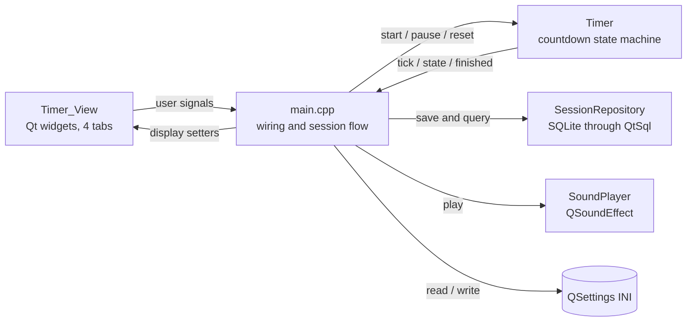
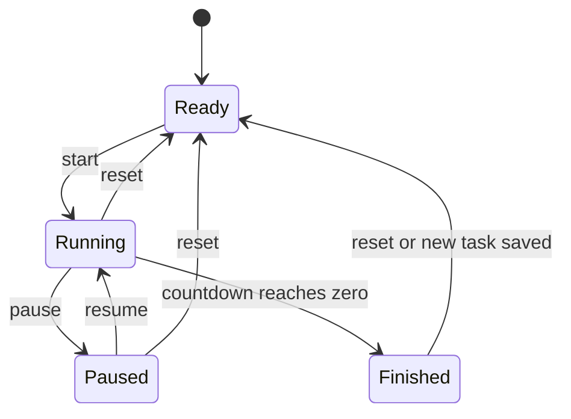
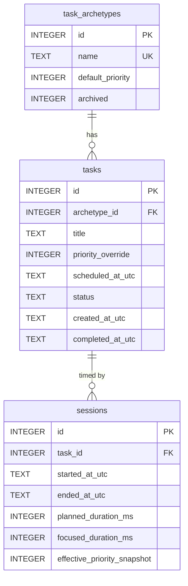
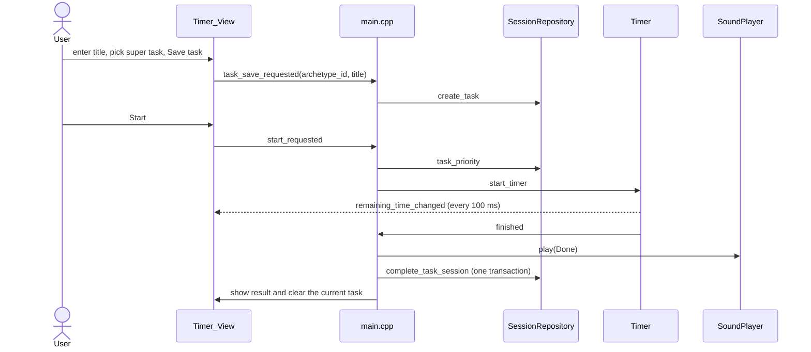

# Productivity Timer

A desktop focus timer written in C++20 with Qt 6. Every countdown is tied to a named task inside a category (a "super task"), every completed session is saved to a local SQLite database, and a Data tab shows where your time went, including a priority-weighted "productive hours" figure.

<!-- Add a screenshot: docs/screenshot.png, then uncomment the next line -->
<!--  -->

**Status:** personal project, in active development. Windows is the primary target. An Android port is planned.

---

## Contents

1. [What it does](#what-it-does)
2. [Tech stack and requirements](#tech-stack-and-requirements)
3. [Build and run](#build-and-run)
4. [Where your data lives](#where-your-data-lives)
5. [Core concepts](#core-concepts)
6. [Architecture](#architecture)
7. [Project layout](#project-layout)
8. [Component reference](#component-reference)
9. [Data model](#data-model)
10. [Key flows](#key-flows)
11. [Signals and slots map](#signals-and-slots-map)
12. [Behavior notes and current limitations](#behavior-notes-and-current-limitations)
13. [Suggested reading order](#suggested-reading-order)
14. [Roadmap](#roadmap)

---

## What it does

- **Task-bound focus sessions.** Save a task (a title plus a super task), then run a countdown against it. Finishing the countdown marks the task completed and records the session.
- **Adjustable session length.** Step the length in 20-minute increments from 5 up to 145 minutes (5, 25, 45, 65, 85, 105, 125, 145). The default is 45. The chosen length persists between runs.
- **Pause, resume, reset.** Pausing preserves the exact remaining time. Reset discards an unfinished session but keeps the selected task active.
- **Manual logging.** Log work you did away from the timer (a walk, a gym session, an application round) by entering a title, super task, start time, and duration.
- **Data tab.** Totals for Day, Week, Month, Year, or All time, plus a per-super-task table showing hours and priority-weighted "productive" hours.
- **Sound feedback.** A short arpeggiated chime when a session finishes and a soft click when a manual log is saved, each with its own enable switch, volume slider, and test button.
- **Failure-safe saving.** If the database write fails when a session ends, the finished session is held in memory and the Start button becomes "Retry save" so the result is not lost.
- **Keyboard shortcut.** Space starts, pauses, or resumes while the Timer tab is active.
- **Dark themed UI** driven by one stylesheet.

---

## Tech stack and requirements

| Item | Detail |
|---|---|
| Language | C++20 |
| UI | Qt 6 Widgets |
| Storage | SQLite through QtSql (`QSQLITE` driver) |
| Audio | Qt Multimedia (`QSoundEffect`, WAV files compiled into the executable) |
| Build | CMake 3.30 or newer (developed in CLion with MinGW 64-bit) |
| Qt version | Developed against Qt 6.11.2. Required modules: Core, Gui, Widgets, Sql, Multimedia |
| Platform | Windows (uses the Windows DWM library and a Windows resource file for the icon) |

Qt Multimedia is not part of a minimal Qt install. If CMake cannot find `Qt6Multimedia`, open the Qt Maintenance Tool, choose "Add or remove components," and add Qt Multimedia for your Qt version.

---

## Build and run

From CLion, open the folder and build the `productivity_timer` target with a Qt-aware profile. From a terminal:

```bash
cmake -S . -B cmake-build-debug -G Ninja -DCMAKE_PREFIX_PATH=<path-to-Qt>/6.x.x/mingw_64
cmake --build cmake-build-debug --target productivity_timer
```

On Windows, when no toolchain file is set, the CMake file adds post-build steps so the executable runs standalone from its build folder:

1. Copies the Qt Core, Gui, Widgets, and Sql DLLs next to the executable.
2. Copies the Windows platform plugin (`qwindows`) and the SQLite driver plugin (`qsqlite`). The build fails with a clear message if the SQLite plugin cannot be found.
3. Runs `windeployqt` against the executable, which pulls in the Multimedia DLLs and plugins.

The startup log prints which SQL drivers are available, the database path, the number of saved sessions, and how many super tasks were loaded.

---

## Where your data lives

| What | Where |
|---|---|
| Sessions database | `productivity-v1.sqlite` in the application local data folder (on Windows typically `%LOCALAPPDATA%\DanielHernandez\ProductivityTimer\`). The exact path is printed at startup as `Database ready: ...` |
| Preferences | An INI file written by `QSettings` (typically `%APPDATA%\DanielHernandez\ProductivityTimer.ini`) |

Preferences are deliberately stored outside the database so that a future database reset does not wipe your sound and timer settings.

INI keys:

| Key | Meaning | Default |
|---|---|---|
| `timer/duration_minutes` | Session length in minutes (snapped to the 5 + 20n grid) | 45 |
| `sound/done_enabled` | Play the finish chime | true |
| `sound/done_volume` | Chime volume, 0 to 100 | 70 |
| `sound/click_enabled` | Play the log click | true |
| `sound/click_volume` | Click volume, 0 to 100 | 60 |

---

## Core concepts

| Term | Meaning |
|---|---|
| **Super task** (archetype) | A category of work, such as Programming or Music. Stored in `task_archetypes`. Each has a default priority and can be archived. |
| **Task** | A titled unit of work under one super task. A task is `active` until its session completes, then `completed`. |
| **Session** | One recorded block of focused time attached to a task, with start and end times, planned and focused durations, and a priority snapshot. |
| **Priority** | An integer from 0 to 4: Leisure (0), Low (1), Normal (2), High (3), Emergency (4). A task's priority is its override if set, otherwise its super task's default. |
| **Priority snapshot** | The priority copied into the session row when it is saved, so changing priorities later never rewrites history. |
| **Productive hours** | The sum of `focused time x priority snapshot` across sessions. A 45-minute Normal (2) session counts as 0.75 focused hours and 1.5 productive hours. Leisure (0) sessions contribute zero productive time. |

Starter super tasks created on first run: Programming (2), Music (1), Exercise (2), Botany/Game (1).

---

## Architecture

The code follows a model / view / persistence split, with `main.cpp` acting as the composition root that creates every object and connects them with Qt signals and slots.



Two connections are made directly instead of through a lambda: the timer's tick signal drives the view's clock label, and the view's pause signal calls the timer's pause slot.

Layer responsibilities:

- **Model (`Timer`)** knows nothing about widgets or the database. It counts down, reports its state, and emits `finished`.
- **View (`Timer_View`)** builds the widgets, exposes plain setter methods, and emits signals when the user acts. It never touches the database or the timer directly.
- **Persistence (`SessionRepository`)** owns the SQLite connection, the schema, and every query. It reports failures through return values and `last_error()`.
- **Audio (`SoundPlayer`)** owns the two sound effects and applies the user's settings.
- **`main.cpp`** holds the session-in-progress state (current task, session draft, pending-save flag) and decides what each signal should do.

---

## Project layout

```
productivity_timer/
├── CMakeLists.txt            Build, deployment, and post-build steps
├── main.cpp                  Composition root, state, and all signal wiring
├── resources.qrc             Embedded icons and WAV files
├── app.rc                    Windows icon resource
├── resources/
│   ├── icons/                timer_icon.png, timer_icon.ico
│   └── sounds/               fantastical_app_arp.wav, log_sound_effect.wav
└── src/
    ├── model/
    │   ├── timer.h / .cpp        Countdown state machine
    │   └── time_range.h          Day / Week / Month / Year / All enum
    ├── persistence/
    │   └── session_repository.h / .cpp   SQLite schema, queries, transactions
    ├── view/
    │   ├── timer_view.h / .cpp   Main window and the four tabs
    │   └── theme.h               Application stylesheet
    ├── audio/
    │   ├── sound_player.h / .cpp Sound playback and volume mapping
    │   └── sound_settings.h      SoundKind enum and SoundSettings struct
    └── controller/               Currently empty (see limitations)
```

---

## Component reference

### `Timer` (`src/model/timer.*`)

A `QObject` state machine with four states: `Ready`, `Running`, `Paused`, `Finished`.



- Time is measured with a `QElapsedTimer` against the remaining time at the last start, not by counting ticks, so the clock does not drift. A 100 ms `QTimer` only refreshes the display and checks whether time has run out.
- Pausing stores the exact remaining milliseconds; resuming continues from it.
- The display rounds up to whole seconds, so the clock reads `00:01` until the final moment and never shows `00:00` early.
- **Length control:** `kMinMinutes = 5`, `kStepMinutes = 20`, `kMaxMinutes = 145`. `snap_minutes()` clamps and rounds any value onto the 5 + 20n grid. `set_duration_minutes()` only works in the `Ready` state.
- Signals: `remaining_time_changed(qint64)`, `state_changed(State)`, `finished()`.

### `Timer_View` (`src/view/timer_view.*`)

A `QMainWindow` whose central widget is a `QTabWidget` with four tabs.

| Tab | Contents |
|---|---|
| **Timer** | Large countdown, length stepper (-20 / +20), status line, current task, Start / Pause / Reset buttons, and the task entry form (title, super task, Save task) |
| **Data** | Range buttons (Day, Week, Month, Year, All), total hours, productive hours, and a per-super-task table |
| **Log** | Manual session form: title, super task, start date and time, duration (1 to 1,440 minutes) |
| **Settings** | Per-sound enable checkbox, volume slider, and Test button |

Notes:

- The Start button's label changes with state: Start, Resume, or Retry save.
- The task form and super task selector lock while a session is running or paused, or while a save is pending.
- The length stepper is disabled whenever the timer is not in `Ready`, and each button also disables at its limit (5 or 145 minutes).
- A Space shortcut is registered on the window. It only acts while the Timer tab is active: it pauses if Pause is enabled, otherwise starts or resumes if Start is enabled.
- The Data tab refreshes when it is selected and when a range button is clicked.

### `SessionRepository` (`src/persistence/session_repository.*`)

Owns one named `QSqlDatabase` connection (a UUID-based name, closed and removed in the destructor). Every public method clears `last_error()` first and returns `false` or `-1` on failure.

| Method | Purpose |
|---|---|
| `initialize()` | Creates the data folder, opens the database, turns on foreign keys and verifies they are active, then creates all tables in one transaction |
| `ensure_starter_archetypes()` | Inserts the four default super tasks, ignoring any that already exist |
| `load_active_archetypes()` | Lists non-archived super tasks, sorted by name |
| `create_archetype()` | Adds a super task (name and default priority). Implemented, not yet exposed in the UI |
| `create_task()` | Inserts an active task, only if the super task exists and is not archived |
| `task_priority()` | Resolves a task's effective priority (override, else default) for an active task |
| `complete_task_session()` | In one transaction: marks the task `completed` and inserts the session row |
| `log_manual_session()` | In one transaction: inserts an already-completed task and its session. Rejects empty titles, invalid times, and sessions that would end in the future |
| `load_usage_summary()` | Totals and per-super-task breakdown for a `TimeRange` |
| `session_count()` | Row count, used at startup |

Details worth knowing:

- Timestamps are stored as UTC ISO-8601 text with milliseconds. Because the format sorts lexically, range filters can compare strings directly.
- Day, Week (Monday start), Month, and Year boundaries are computed in local time and converted to UTC. "All" uses a fixed minimum date.
- All statements use bound parameters, never string concatenation.
- Both write paths use a local `fail()` helper that records the error and rolls back the transaction.

### `SoundPlayer` (`src/audio/*`)

- Holds two `QSoundEffect` instances loaded from the embedded `qrc:/resources/sounds/` files at startup.
- `play(kind)` respects the enable flag. `play_test(kind)` ignores it (used by the Test buttons).
- Slider position is converted to volume by squaring, which feels more even to the ear than a linear mapping.
- If a sound fails to load, a warning is logged and playback is skipped.

### `theme.h`

A single inline function that returns the application stylesheet. Main palette: background `#0F1B2D`, text `#E6EDF7`, accent orange `#FF8A1F`, blue borders `#2F5FA8`. Specific widgets are styled through object names such as `timerLabel`, `startButton`, and `rangeButton`.

---

## Data model



Constraints enforced by the database:

- `task_archetypes.name` is unique. `default_priority` is between 0 and 4, `archived` is 0 or 1.
- `tasks.status` is one of `active`, `completed`, or `archived`. `priority_override`, when set, is between 0 and 4.
- `sessions.planned_duration_ms` must be greater than zero. `focused_duration_ms` must be zero or more. The priority snapshot is between 0 and 4.
- Both foreign keys use `ON DELETE RESTRICT`, so history can never be orphaned by deleting a task or super task. Foreign-key enforcement is switched on at connection time and checked at startup.

Design choices:

- **Priority snapshot.** Each session stores the priority it was recorded with, so productive-hours history stays fixed if defaults change later.
- **UTC everywhere.** Local time is only used when computing range boundaries and displaying the log form.
- **Reserved columns.** `priority_override`, `scheduled_at_utc`, and the `archived` task status exist in the schema for planned features but no screen sets them yet.

---

## Key flows

### Running a timed session



1. **Save a task.** The task is created as `active` and becomes the current task. The timer is reset to `Ready`.
2. **Start.** The task's effective priority is looked up and a session draft is created in memory with the start time (UTC), the priority, and the planned length (the current timer length in milliseconds).
3. **Countdown.** The timer ticks; pause and resume work against the stored remaining time.
4. **Finish.** The chime plays, the end time is stamped, and a pending-save flag is set. The repository then marks the task completed and writes the session in one transaction.
5. **After saving.** The current task is cleared, and a new task must be saved before the next session.

### When the save fails

If the completion write fails, the draft and pending-save flag stay in memory. The status line reports the failure, Reset is disabled so the result cannot be discarded by accident, and the Start button becomes **Retry save**. Pressing it retries the same write.

### Logging a session manually

The Log tab collects a title, super task, start time, and a duration in minutes. The repository checks the inputs, then in one transaction inserts a completed task and its session. The session's priority is the super task's default priority. On success the click sound plays and the title field clears.

### Reading the Data tab

Selecting the tab or a range button triggers `load_usage_summary()`. Sessions are included when their end time falls on or after the range start. The per-super-task query uses left joins, so super tasks with no sessions still appear with zero hours, sorted by productive time.

---

## Signals and slots map

Signals emitted by `Timer_View`:

| Signal | Handled in `main.cpp` by |
|---|---|
| `start_requested()` | Retry a pending save, resume a paused session, or start a new one (checks that a task exists) |
| `pause_requested()` | Connected directly to `Timer::pause_timer` |
| `reset_requested()` | Discards the unfinished session and resets the timer (ignored while a save is pending) |
| `task_save_requested(id, title)` | Creates the task, selects it, resets the timer |
| `data_view_requested()` | Reloads the usage summary |
| `time_range_changed(range)` | Stores the range and reloads the summary |
| `manual_log_requested(id, title, start, minutes)` | Writes the manual session and plays the click |
| `duration_step_requested(direction)` | Steps the timer length by 20 minutes, saves it, and refreshes the stepper |
| `sound_settings_changed(settings)` | Applies the settings and writes them to the INI file |
| `sound_test_requested(kind)` | Plays the sound regardless of its enable flag |

Signals emitted by `Timer`:

| Signal | Handled by |
|---|---|
| `remaining_time_changed(ms)` | Connected directly to `Timer_View::set_remaining_time` |
| `state_changed(state)` | Refreshes button states and task-form locking |
| `finished()` | Plays the chime, stamps the end time, and saves the session |

---

## Behavior notes and current limitations

- A timed session is only recorded when the countdown completes. Reset discards progress with no partial credit, which is why focused duration always equals planned duration for timed sessions.
- Each task holds one timed session. After a session is saved, the current task is cleared and a new one must be saved.
- An in-progress session lives in memory only. Closing the app mid-session loses it.
- The length stepper only works while the timer is `Ready`. After a session finishes, it becomes available again once a new task is saved or Reset is pressed.
- Database calls run synchronously on the UI thread, which is fine for a local SQLite file at this scale.
- `create_archetype()`, `priority_override`, `scheduled_at_utc`, and the `archived` task status are supported by the data layer but have no UI yet.
- The Data tab lists every super task, including archived ones.
- `apply_dark_title_bar()` in `main.cpp` is defined but not currently called.
- `src/controller/` is empty. The session flow currently lives in `main.cpp` lambdas and is a candidate for extraction into a controller class.
- There are no automated tests yet.

---

## Suggested reading order

1. `src/model/timer.h`, then `timer.cpp`. Self-contained and short.
2. `src/persistence/session_repository.h` for the types, then `session_repository.cpp`: `initialize()` first, then `complete_task_session()`, then `load_usage_summary()`.
3. `src/view/timer_view.h`, then the constructor in `timer_view.cpp`, then `set_controls()` and `set_task_context()`, then the three page builders.
4. `main.cpp` from top to bottom: setup, state variables, the two helper lambdas (`refresh_controls`, `save_completion`), then each `connect` block.
5. `src/audio/` and `theme.h`.

Qt ideas that appear throughout: signals and slots (including lambda connections capturing locals by reference, which is safe here because those locals outlive `app.exec()`), `QObject` parent ownership for cleanup, `AUTOMOC` for generating signal and slot glue, the Qt resource system for embedded files, and named `QSqlDatabase` connections.

---

## Roadmap

- Manage super tasks from the Settings tab, including adding new categories (for example a Work category for job applications) without touching the database by hand.
- In-app database initialization and reset, protected by an interface warning, a confirmation dialog, and an automatic backup of the existing database file first.
- Android port.
- Extract session orchestration from `main.cpp` into a controller, and add repository tests.

---

## License

To be decided.